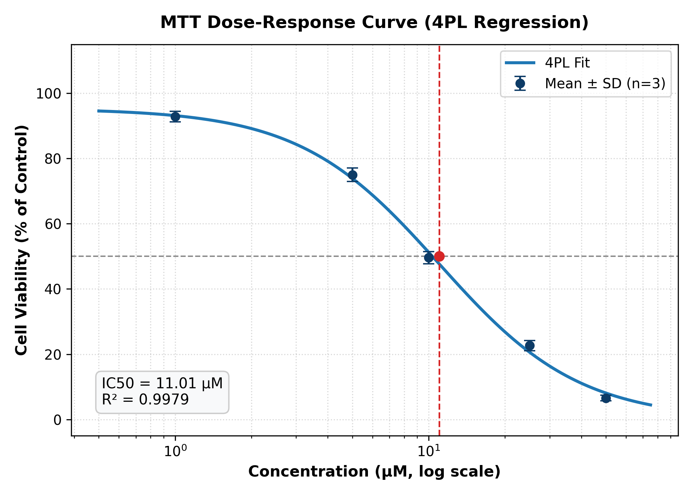

# mtt-viability-cli

Automated command-line pipeline for normalizing 96-well plate MTT/viability assay data, computing group summary statistics (Mean ± SD), and fitting 4-parameter logistic (4PL) dose-response curves to calculate **IC50** values.

## Features
- **Automated Plate Normalization:** Subtracts mean blank absorbance and normalizes treatment wells against untreated controls using pure `awk`.
- **Replicate Aggregation:** Computes sample size (N), mean cell viability (%), and sample standard deviation (SD) per concentration group.
- **4PL Nonlinear Regression & Plotting:** Fits a 4-parameter logistic curve (`scipy.optimize.curve_fit`) to estimate IC50, Hill slope, and R², generating a 300 DPI dose-response plot.

## Project Structure
- `data/raw_plate_example.csv` — Example 96-well plate absorbance data (570 nm)
- `scripts/analyze_mtt.sh` — Main CLI pipeline (Bash + AWK)
- `scripts/fit_ic50.py` — 4PL regression and visualization module
- `results/viability_summary.tsv` — Normalized viability summary table
- `results/viability_summary.png` — Publication-ready dose-response curve

## Installation & Quick Start
Run the following commands in your terminal:

    git clone https://github.com/<your-username>/mtt-viability-cli.git
    cd mtt-viability-cli
    python3 -m venv .venv
    source .venv/bin/activate
    pip install -r requirements.txt
    chmod +x scripts/analyze_mtt.sh
    ./scripts/analyze_mtt.sh

To analyze your own plate file:

    ./scripts/analyze_mtt.sh -i data/your_plate.csv -o results/custom_output.tsv

## Example Output

| Group | Dose (µM) | N | Mean Viability (%) | SD |
| :--- | :---: | :---: | :---: | :---: |
| Control | 0 | 3 | 100.00 | 1.73 |
| Treatment | 1 | 3 | 92.85 | 1.60 |
| Treatment | 5 | 3 | 75.02 | 2.11 |
| Treatment | 10 | 3 | 49.59 | 1.90 |
| Treatment | 25 | 3 | 22.65 | 1.60 |
| Treatment | 50 | 3 | 6.54 | 0.86 |

